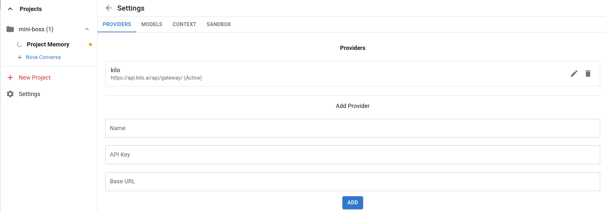
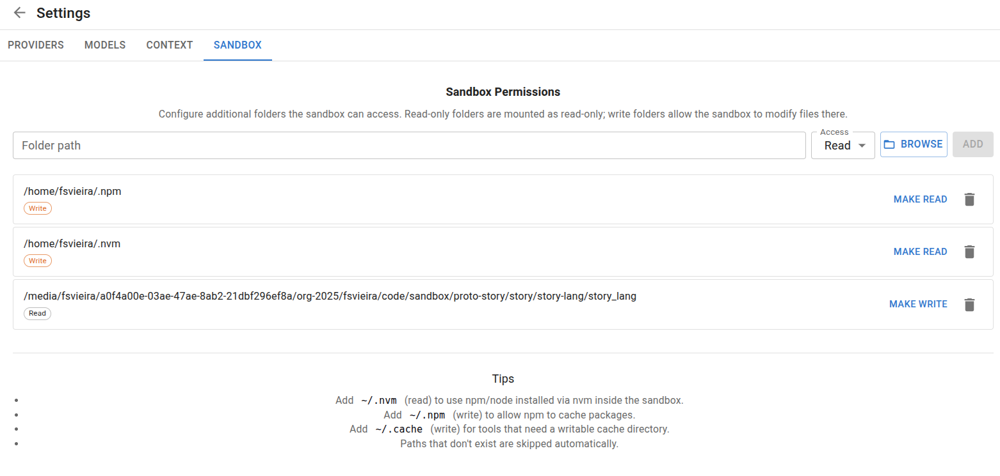
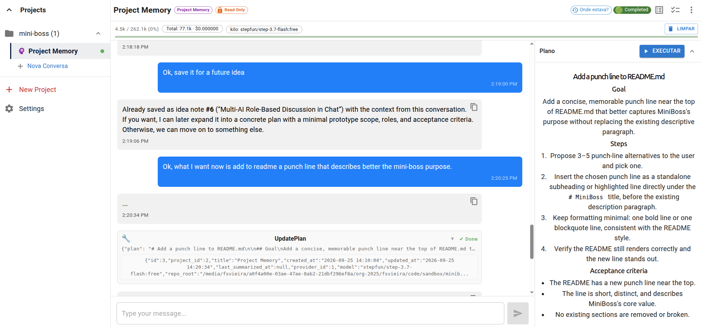
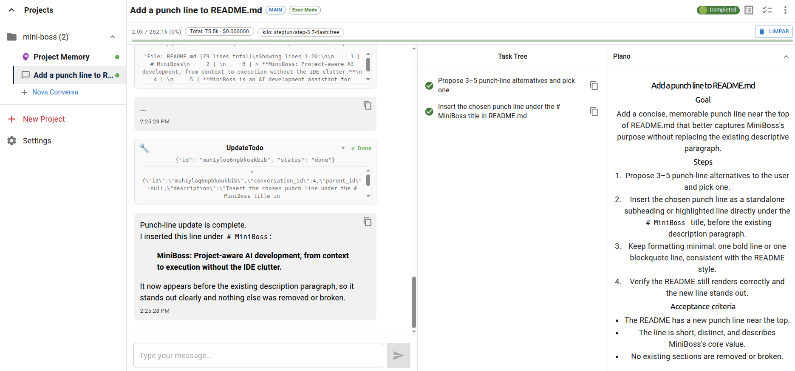
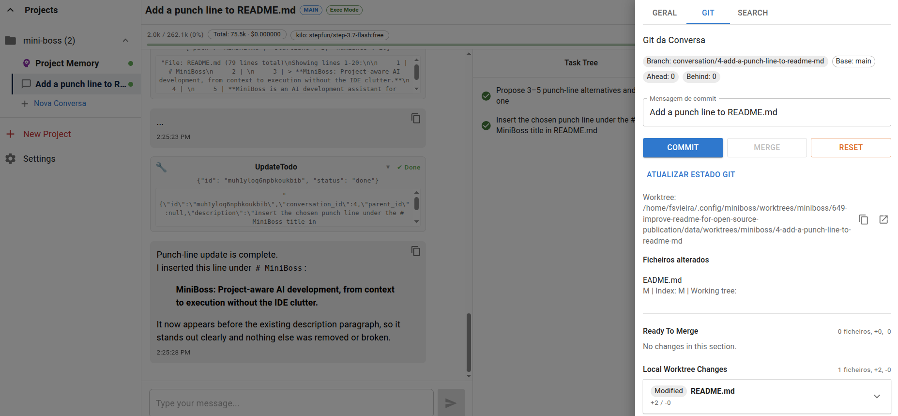

# MiniBoss

**MiniBoss is a project-aware AI development assistant for working across multiple Git projects without switching IDEs.** It combines persistent project memory, isolated Git worktrees, and a sandboxed execution environment so you can plan, implement, and review work from one place.

Every project you add to MiniBoss must already be a Git repository.

> **Notice:** MiniBoss is under active development. It may contain bugs or breaking changes. You are welcome to try it, but use it with care.

## Security

MiniBoss uses Git worktrees together with a **rootless Podman** sandbox to limit the assistant's access:

- The assistant operates inside the active worktree. The worktree is bind-mounted inside an isolated container at the same absolute path, so nothing is written outside it from within an execution conversation.
- The base repository is mounted **read-only**; it is only modified through explicit Git operations that you initiate in the Git section.
- The container runs with `--userns=keep-id` (so the files it writes stay owned by your user), `--cap-drop=ALL` and `no-new-privileges`.
- The container receives an **explicit environment allowlist** (`HOME`, `PATH`, `LANG`, `TZ`, `CI`) — the host environment is never leaked into the command.
- One container is kept per conversation worktree, so the npm cache and the project setup survive between commands. Idle containers are stopped (not deleted) and removed when the conversation is deleted.

However, this boundary is **not absolute**:

- If the assistant invokes external services—such as a MySQL database, remote APIs, or other networked tools—those interactions are **not** confined by the worktree sandbox. The sandbox controls filesystem and process isolation within the worktree; it does not restrict outbound connections or external state changes.
- **The file tools (`writeFile`, `editFile`, `moveFile`, `deleteFile`, `copyFile`, `createDirectory`) are not sandboxed**: they write directly to the host filesystem. In plan mode they are removed from the tool list and blocked by the tool processor, but the command sandbox is the only boundary for `runCommand`.
- Extra paths configured in the **Sandbox** settings are mounted into the container according to their access mode (`read` or `write`); treat a `write` entry as granting the assistant write access to that path.

The sandbox is currently **Linux-only** and requires rootless Podman (`podman`) to be installed and working. MiniBoss verifies it on startup and will not run without it. The previous bubblewrap sandbox is still available with `SANDBOX_RUNTIME=bwrap`.

| Variable | Default | Meaning |
|---|---|---|
| `SANDBOX_RUNTIME` | `podman` | `podman` or `bwrap` |
| `SANDBOX_IMAGE` | `docker.io/library/node:22-bookworm` | Container image |
| `SANDBOX_IDLE_TTL_MIN` | `10` | Minutes after which an idle container is stopped |
| `SANDBOX_NETWORK` | `default` | `default` (rootless network) or `none` |
| `SANDBOX_CONTAINER_HOME` | `/home/miniboss` | `HOME` inside the container (also the npm cache) |
| `PODMAN_BIN` | auto-detected | Path to the `podman` binary |

### Installing Podman without root

Rootless Podman works without any system package, using the static build:

```bash
curl -fsSL -o podman.tar.gz \
  https://github.com/mgoltzsche/podman-static/releases/latest/download/podman-linux-amd64.tar.gz
tar xzf podman.tar.gz
cp -r podman-linux-amd64/usr podman-linux-amd64/etc ~/
```

Then point `~/.config/containers/containers.conf` at the helper binaries
(`conmon`, `crun`, `netavark`) and expose a `podman` wrapper in `~/.local/bin`.
Without the `uidmap` package (`newuidmap`/`newgidmap`) the container can only
map a single UID — enough for the sandbox, since `--userns=keep-id` maps the
container root to the host user, but the full sub-UID range is preferable:

```bash
sudo apt-get install -y podman uidmap
```


## Features

- **Project memory** — persistent notes about decisions, architecture, pending work, and context across sessions.
- **Worktree isolation** — implementation work happens in dedicated Git worktrees, keeping changes separate from your main branch and from other tasks.
- **Sandboxed execution** — the assistant operates inside the active worktree, with filesystem and command access restricted by project settings.
- **Settings & providers** — configurable sandbox rules, tool providers, and per-project behavior.
- **Execution conversations** — focused sessions for modifying, testing, and reviewing code with approval gates.
- **Git operations** — inspect, commit, merge, and manage branches from within execution conversations.

## Screenshots


*Project settings, sandbox controls, and provider configuration.*


*Project settings, sandbox global permissions example.*


*Persistent project memory alongside plan and execute workflows.*


*Focused execution session with TODO list and embedded plan.*


*Reviewing code changes, commit, and merge inside an execution conversation.*

## Setup

Use `server/.env.example` as a template to create your local `server/.env`. This file is local-only and not committed to Git.

## Quick Start

### Prerequisites

- Node.js v18+
- npm

### Install

```bash
npm install
cd server && npm install
cd ../web && npm install
```

### Run

Start the backend:

```bash
cd server
npm run start
```

Then start the web client:

```bash
cd web
npm run dev
```

Frontend: http://localhost:5300  
Backend: http://localhost:3200

In development, Vite proxies `/api` to the backend.

For a production build of the frontend:

```bash
cd web
npm run build
```

Serve the built `web/dist` assets from your web server and proxy `/api` to the backend.

## Contributing

See [CONTRIBUTING.md](CONTRIBUTING.md) for setup, workflow, and pull request guidelines.

## License

MIT — see [LICENSE](LICENSE) for details.
